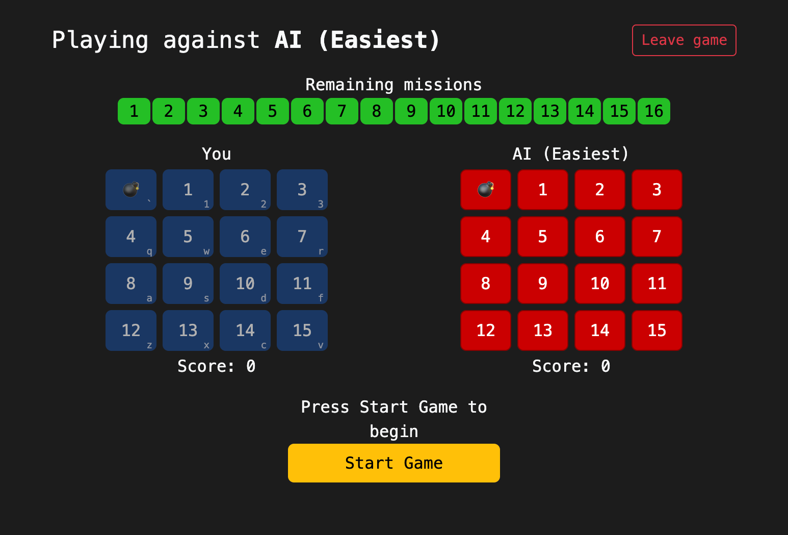

# Spymaster

J. M. F. Tsang (j.m.f.tsang@cantab.net)

---

Play now: https://spymaster.fastapicloud.dev/

This is a remake of Richard Bartle's game [Spymaster][bartle], rewritten
with a Python backend, a modernized frontend, and the ability to define
custom AI players. 

Spymaster is based on [Goofspiel][goofspiel], a classic game of bluffing
and double-bluffing. Read [the rules](HowToPlay.md) for instructions.

[bartle]: https://www.youhaventlived.com/spymaster/
[goofspiel]: https://en.wikipedia.org/wiki/Goofspiel

## Usage



```bash
# Start a webserver
python -m spymaster.webserver
# then go to http://localhost:8000
```
```bash
# Play against a computer player
python -m spymaster Russia
```
```bash
# Play two AIs against each other
python -m spymaster Russia America
```

## Mobile apps

The `android/` and `ios/` projects are Capacitor wrappers around the web app.
They load the deployed site in a WebView; game state, AI opponents and analysis
remain on the server, and there is no offline play.

Prerequisites:

- Android Studio with the Android SDK installed.
- Xcode and CocoaPods on macOS.

From the repository root:

```bash
npm install
npm run cap:sync     # rebuild the web assets and sync the native projects
npm run cap:android  # open the Android project in Android Studio
npm run cap:ios      # open the iOS project in Xcode
```

Build and run the opened project from Android Studio or Xcode. `capacitor.config.ts`
points the WebView at `https://spymaster.fastapicloud.dev/`; the copied web
assets under `dist/frontend/` are kept for PWA builds, but the native apps do
not use them for gameplay.

For local development, temporarily change `remoteOrigin` in
`capacitor.config.ts` to the URL of your running backend (use an address
reachable from the device or emulator), run `npm run cap:sync`, and revert the
change before committing.
