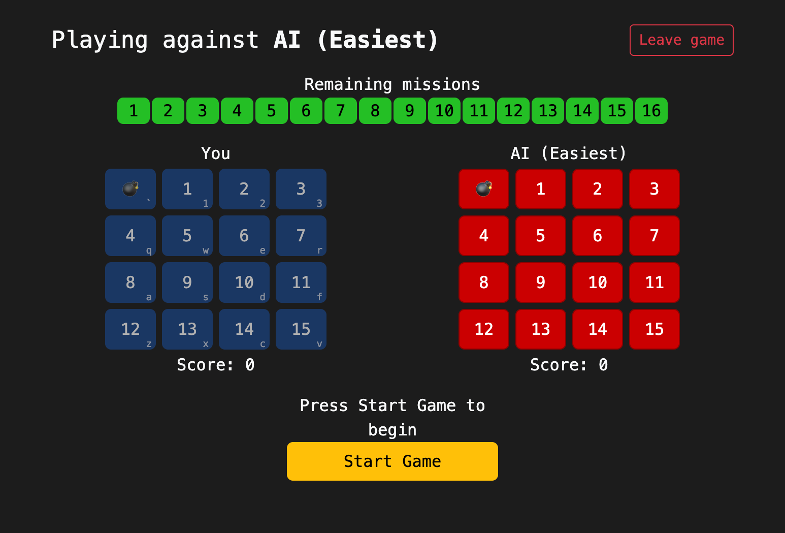

# Spymaster

J. M. F. Tsang (j.m.f.tsang@cantab.net)

---

Play now: https://spymaster.fastapicloud.dev/

This is a remake of Richard Bartle's game [Spymaster][bartle], rewritten
with a Python backend, a modernized frontend, and the ability to define
custom AI players. 

Spymaster is based on [Goofspiel][goofspiel], a classic game of bluffing
and double-bluffing. Read [the rules](HowToPlay.md) for instructions.

[bartle]: https://www.youhaventlived.com/spymaster/
[goofspiel]: https://en.wikipedia.org/wiki/Goofspiel

## Usage



```bash
# Start a webserver
python -m spymaster.webserver
# then go to http://localhost:8000
```
```bash
# Play against a computer player
python -m spymaster Russia
```
```bash
# Play two AIs against each other
python -m spymaster Russia America
```
